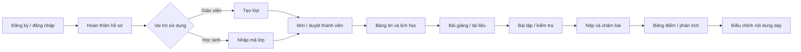

# Phạm vi và luồng nghiệp vụ

## 1. Luồng tổng thể

## 2. Tài khoản và onboarding

### Đăng ký

- Người dùng chọn mục đích ban đầu: `Giáo viên` hoặc `Học sinh`.
- Đăng ký bằng email + mật khẩu ở P0. Email phải được xác minh trước khi tạo/tham gia lớp.
- Họ tên là bắt buộc; ảnh đại diện, trường, tỉnh/thành và ngày sinh là tùy chọn.
- Vai trò chọn khi onboarding chỉ điều chỉnh giao diện mặc định, không tự cấp quyền quản trị lớp.
- Một tài khoản có thể vừa dạy lớp A vừa học lớp B; quyền thật nằm ở từng lớp.

### Đăng nhập và khôi phục

- Đăng nhập bằng email + mật khẩu.
- Quên mật khẩu dùng email magic link của Supabase Auth.
- Sau khi đổi email/mật khẩu, thu hồi các phiên cũ nếu Supabase hỗ trợ ở luồng tương ứng.
- Trang hồ sơ cho đổi tên, avatar, thông tin trường và tùy chọn nhận email.

## 3. Vòng đời lớp học

### Tạo lớp

Giáo viên nhập tên lớp, môn, khối/lớp, năm học, mô tả ngắn và ảnh bìa. Hệ thống tạo:

- `join_code` ngẫu nhiên, không tuần tự, có thể tạo lại.
- Thành viên chủ lớp với vai trò `owner`.
- Cấu hình mặc định: cần duyệt thành viên, học sinh được bình luận, múi giờ `Asia/Bangkok`.

### Tham gia lớp

1. Học sinh nhập mã lớp hoặc mở link mời.
2. Nếu lớp đóng hoặc mã hết hiệu lực, hệ thống từ chối rõ lý do.
3. Nếu lớp yêu cầu duyệt, thành viên ở trạng thái `pending` và chưa xem nội dung riêng tư.
4. Chủ lớp/giáo viên duyệt hoặc từ chối.
5. Khi được duyệt, học sinh nhận thông báo và thấy lớp trên dashboard.

### Lưu trữ lớp

- `archive`: lớp chỉ đọc với học sinh; giáo viên vẫn xem và xuất dữ liệu.
- `restore`: chủ lớp mở lại lớp.
- `delete`: P0 chưa xóa cứng qua UI. Chỉ đánh dấu xóa, giữ thời gian khôi phục 30 ngày.

## 4. Chu kỳ dạy học chuẩn

### Trước buổi học

- Giáo viên tạo lịch học, gắn link họp/phòng học và tài liệu chuẩn bị.
- Đăng bài giảng ở trạng thái nháp, lên lịch xuất bản hoặc xuất bản ngay.
- Giao nhiệm vụ đọc trước/bài kiểm tra đầu vào cho cả lớp hoặc nhóm.
- Học sinh nhận thông báo và thấy nhiệm vụ trên dashboard.

### Trong buổi học

- Học sinh mở bài giảng và tài liệu đã công bố.
- Giáo viên đăng thông báo nhanh, cập nhật link học.
- P1: giáo viên điểm danh và ghi chú đi muộn/vắng có phép.

### Sau buổi học

- Giáo viên giao bài, đặt hạn nộp và quy tắc nộp muộn.
- Học sinh làm/nộp bài, có biên nhận thời gian và phiên bản nộp.
- Hệ thống chấm phần trắc nghiệm; giáo viên chấm phần tự luận/tệp.
- Điểm ở trạng thái nháp cho đến khi giáo viên trả bài.
- Học sinh xem điểm, đáp án theo chính sách và phản hồi.

## 5. Quy tắc xuất bản nội dung

Mọi nội dung dạy học dùng chung vòng đời:

- `draft`: chỉ người có quyền biên soạn thấy.
- `scheduled`: tự xuất bản tại thời điểm cấu hình.
- `published`: đối tượng được giao có thể xem.
- `archived`: ngừng hiển thị trong danh sách mặc định nhưng không mất dữ liệu.

Thời gian lưu trong database dùng UTC, hiển thị theo múi giờ lớp. Khi sửa nội dung đã xuất bản, cập nhật `updated_at` và ghi audit log.

## 6. Dashboard

### Học sinh

- Việc đến hạn trong 7 ngày, ưu tiên quá hạn/sắp hết hạn.
- Lịch học hôm nay và sắp tới.
- Bài mới, điểm/phản hồi mới trả.
- Tiến độ theo lớp: đã hoàn thành, cần làm, quá hạn.

### Giáo viên

- Lịch dạy sắp tới.
- Bài đang mở và số lượng đã nộp/chưa nộp/cần chấm.
- Yêu cầu tham gia lớp đang chờ.
- Cảnh báo học sinh quá hạn nhiều hoặc điểm giảm (P1).

## 7. Các trạng thái quan trọng

| Đối tượng | Trạng thái |
|---|---|
| Thành viên lớp | `pending`, `active`, `rejected`, `removed` |
| Lớp | `active`, `archived`, `deleted` |
| Nội dung | `draft`, `scheduled`, `published`, `archived` |
| Bài tập | kế thừa nội dung + `closed` khi ngừng nhận bài |
| Bài nộp | `draft`, `submitted`, `late`, `returned`, `resubmitted` |
| Điểm | `draft`, `published`, `excused` |

## 8. Tình huống biên bắt buộc xử lý

- Học sinh nhập mã lớp nhiều lần: không tạo membership trùng.
- Mã lớp bị lộ: chủ lớp tạo mã mới; mã cũ hết hiệu lực ngay.
- Giáo viên rời lớp: phải chuyển quyền owner trước.
- Xóa thành viên đã nộp bài: giữ bài nộp/điểm cho giáo viên, học sinh mất quyền lớp.
- Hạn nộp đổi sau khi có bài nộp: không tự đổi trạng thái lịch sử nếu không có thao tác xác nhận.
- Mất mạng khi nộp: chỉ xác nhận thành công sau khi server tạo biên nhận.
- File trùng tên: lưu bằng UUID, chỉ giữ tên gốc trong metadata.
- Tự động chấm lại: lưu phiên bản đáp án và lịch sử điểm, không ghi đè không dấu vết.
