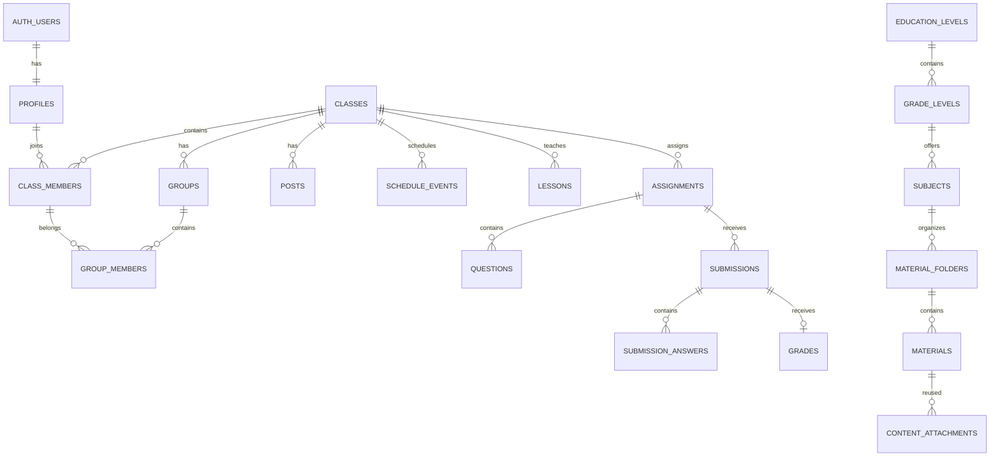

# Mô hình dữ liệu đề xuất

## 1. Sơ đồ mức cao

## 2. Nhóm tài khoản

### `profiles`

`id` (FK auth.users), `display_name`, `avatar_path`, `school_name`, `province_code`, `date_of_birth`, `platform_role`, `onboarding_mode`, `email_notifications`, timestamps.

Không nhân bản email nếu không có lý do truy vấn rõ ràng; email chuẩn nằm trong Supabase Auth.

## 3. Nhóm lớp và thành viên

### `classes`

`id`, `owner_id`, `name`, `description`, `cover_path`, `subject_id`, `grade_level_id`, `academic_year`, `timezone`, `join_code_hash`, `join_code_hint`, `join_requires_approval`, `allow_comments`, `status`, timestamps, `deleted_at`.

- Chỉ lưu hash của mã tham gia nếu luồng tra cứu được triển khai bằng RPC an toàn.
- Index: owner, status, subject, join-code lookup.

### `class_members`

`id`, `class_id`, `user_id`, `role`, `status`, `capabilities jsonb`, `joined_at`, `reviewed_by`, timestamps.

Ràng buộc unique `(class_id, user_id)`.

### `groups` và `group_members`

- `groups`: `id`, `class_id`, `name`, `description`, `color`, `leader_member_id`, timestamps, `deleted_at`.
- `group_members`: `group_id`, `class_member_id`, timestamps; unique cặp.

## 4. Nhóm giao tiếp và lịch

### `posts`, `post_comments`

- `posts`: class, author, title tùy chọn, body dạng JSON đã sanitize, status, publish_at, pinned_at, comment_locked, timestamps.
- `post_comments`: post, author, body, timestamps, deleted_at. P0 chỉ một cấp.

### `schedule_series`, `schedule_events`

- Series giữ quy tắc lặp và ngày kết thúc.
- Event giữ từng occurrence cụ thể: start/end UTC, location, meeting_url, status.
- Việc materialize occurrence giúp nhắc lịch và sửa một buổi dễ hơn.

### Target dùng chung

`content_targets(id, class_id, entity_type, entity_id, target_type, target_id)`.

- `target_type`: `class` hoặc `group`.
- Tránh tạo bảng target riêng lặp lại cho post/lesson/resource/assignment/event.
- Validate `target_id` thuộc đúng `class_id` bằng trigger/RPC.

## 5. Bài giảng và tiến độ

### `lesson_modules`, `lessons`, `lesson_progress`

- Module/chủ đề sắp xếp bằng `position`.
- Lesson chứa nội dung, video URL, trạng thái, publish_at.
- Progress unique `(lesson_id, user_id)` với status và completed_at.

### `content_attachments`

Liên kết file/link/material tới post, lesson, assignment hoặc event. Trường chính: `entity_type`, `entity_id`, `attachment_type`, `file_object_id/material_id/url`, `position`.

## 6. Bài tập, câu hỏi và bài nộp

### `assignments`

Class, author, type, title, instructions, status, open_at, due_at, close_at, duration_minutes, max_attempts, late_policy, score_release_policy, answer_release_policy, max_score, randomization config, timestamps.

### `questions`, `question_options`, `question_keys`

- Question: type, prompt JSON, points, position, explanation, source bank id.
- Option: nội dung và position, không chứa `is_correct` ở payload học sinh.
- Key: đáp án chuẩn/logic chấm, tách quyền đọc.
- Dùng UUID cho câu/option để không lộ quy luật và hỗ trợ trộn.

### `submission_attempts`

`id`, assignment, student, attempt_no, status, started_at, submitted_at, server_received_at, is_late, idempotency_key, client_version, timestamps.

Unique `(assignment_id, student_id, attempt_no)` và `(student_id, idempotency_key)`.

### `submission_answers` và `submission_files`

- Answer lưu question, response JSON, autoscore, grader_score, feedback, graded_by/at.
- File lưu object path, original name, MIME, size, checksum, scan status.

### `grades` và `grade_history`

- Grade: attempt, raw_score, final_score, status, overall_feedback, published_at.
- History append-only: before/after, reason, actor, time.

## 7. Bảng điểm

### `grade_categories`, `grade_items`, `grade_entries`

- Category: class, name, weight (P1).
- Item: class, category, assignment nullable, title, max_score, weight, visibility.
- Entry: item, student, score, state (`graded`, `missing`, `excused`, `absent`), feedback.

Bài tập có thể tự tạo một grade item. Grade entry là lớp tổng hợp hiển thị; grade/submission giữ chi tiết chấm.

## 8. Kho học liệu

### Taxonomy

- `education_levels(id, code, name, position, active)`
- `grade_levels(id, education_level_id, code, name, position, active)`
- `subjects(id, grade_level_id nullable, code, name, active)`

Nếu cùng một môn dùng cho nhiều khối, cân nhắc bảng nối `grade_subjects` thay cho FK trực tiếp sau MVP.

### `material_folders`

`id`, owner_id nullable, subject_id, parent_id nullable, name, scope, class_id nullable, path_cache tùy chọn, position, timestamps, deleted_at.

- Unique tên trong cùng parent/phạm vi/owner.
- Trigger/RPC ngăn parent là chính nó hoặc descendant.

### `materials`, `material_versions`

- Material: folder, creator, title, description, kind, scope, status, tags, current_version_id, timestamps, deleted_at.
- Version: material, storage object, URL/text content, MIME, size, checksum, created_by/at.
- Không sửa version cũ; thay file tạo version mới.

## 9. Thông báo và vận hành

### `notifications`, `notification_deliveries`

- Notification: recipient, type, payload tối thiểu, entity link, created_at, read_at.
- Delivery: channel, provider id, status, attempts, error, sent_at.

### `audit_logs`

Append-only: actor, action, entity_type/id, class_id, before/after JSON đã loại bí mật, IP hash/user-agent tùy chính sách, created_at.

### `outbox_events`

Ghi sự kiện nghiệp vụ trong cùng transaction, worker/Edge Function xử lý email/nhắc hạn. Có `status`, `available_at`, `attempt_count`, `last_error`; tránh mất email khi request chính thành công nhưng provider lỗi.

## 10. Quy ước dữ liệu

- PK dùng UUID; timestamps dùng `timestamptz` UTC.
- Soft delete cho lớp/nội dung/tài liệu; audit/history không xóa qua UI.
- Index mọi FK hay dùng, `status`, `publish_at`, `due_at`, `recipient_id + read_at`.
- Dùng constraint/check cho score >= 0, end > start, due >= open, attempt_no > 0.
- Rich text lưu JSON có schema và sanitize ở server; không lưu/render HTML tùy ý.
- Migration là nguồn sự thật; thay đổi schema production luôn qua migration có version.
