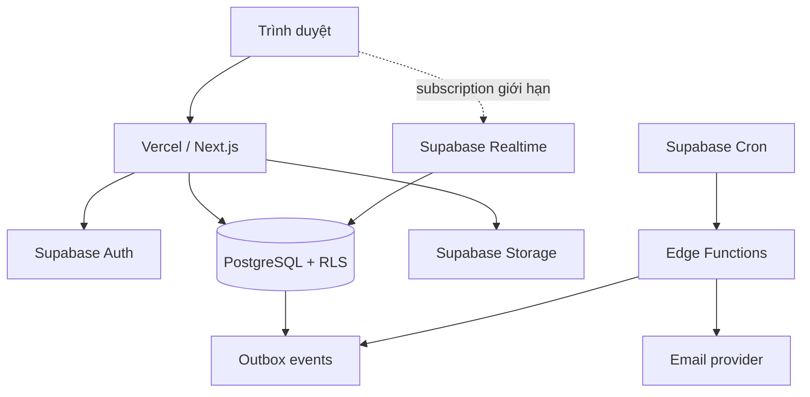

# Kiến trúc kỹ thuật Vercel + Supabase

## 1. Stack đề xuất

| Lớp | Công nghệ |
|---|---|
| Web | Next.js App Router + TypeScript |
| UI | Tailwind CSS + shadcn/ui hoặc bộ component tương đương |
| Form/validation | React Hook Form + Zod; schema quan trọng dùng lại phía server |
| Backend giao diện | Server Components, Server Actions/Route Handlers |
| Auth | Supabase Auth |
| Database | Supabase PostgreSQL + RLS |
| File | Supabase Storage private buckets |
| Realtime | Supabase Realtime có chọn lọc cho notification/bảng tin |
| Job nền | Supabase Edge Functions + cron/outbox |
| Hosting | Vercel |
| Email | Resend hoặc provider transactional email, gọi từ backend/Edge Function |
| Theo dõi lỗi | Sentry hoặc Vercel Observability; không ghi nội dung bài/đáp án vào log |

## 2. Sơ đồ triển khai



## 3. Ranh giới client/server

### Client được phép

- Dùng Supabase anon key (public theo thiết kế) với RLS bật.
- Đọc/ghi dữ liệu ít nhạy cảm theo policy rõ ràng.
- Upload trực tiếp bằng signed upload URL sau khi server xác thực quyền/quota.

### Chỉ server

- Service role key.
- Tạo signed URL cho tệp nhạy cảm.
- Chấm bài, tính điểm, công bố điểm, đổi vai trò, chuyển owner.
- Đọc đáp án đúng và xử lý job/email.
- Admin operations và audit log.

Các mutation quan trọng nên đi qua RPC/database transaction hoặc Route Handler để tránh cập nhật nửa chừng.

## 4. Cấu trúc ứng dụng gợi ý

```text
src/
├── app/
│   ├── (public)/
│   ├── (auth)/
│   ├── (dashboard)/
│   │   ├── classes/[classId]/
│   │   ├── materials/
│   │   └── settings/
│   └── api/
├── components/
│   ├── ui/
│   └── features/
├── features/
│   ├── auth/
│   ├── classes/
│   ├── assignments/
│   ├── gradebook/
│   └── materials/
├── lib/
│   ├── supabase/
│   ├── authz/
│   ├── validation/
│   └── observability/
└── types/
supabase/
├── migrations/
├── functions/
└── seed.sql              # chỉ dữ liệu tham chiếu an toàn nếu cần
```

Ưu tiên module theo nghiệp vụ, không gom toàn bộ query/action vào một thư mục `utils` chung.

## 5. Nguyên tắc API và mutation

- Validate input server-side bằng schema.
- Kiểm tra auth → membership → capability → trạng thái đối tượng → mutation.
- Transaction cho: tham gia lớp, chuyển owner, nộp bài, công bố điểm, di chuyển/xóa học liệu.
- Idempotency key cho nộp bài, email event và các thao tác có thể retry.
- Pagination dạng cursor cho bảng tin, thông báo, bài nộp; không tải toàn bộ lớp lớn.
- Trả error code ổn định (`CLASS_FORBIDDEN`, `ASSIGNMENT_CLOSED`), UI mới dịch sang tiếng Việt.

## 6. File và dung lượng

Giới hạn khởi điểm có thể điều chỉnh theo quota Supabase:

- Avatar/ảnh bìa: 5 MB.
- Tài liệu: 50 MB/file.
- Bài nộp: 100 MB/lượt, tối đa 10 file.
- Video lớn: P0 ưu tiên link YouTube/Vimeo/Drive có quyền phù hợp; không host video dài trực tiếp.

Upload flow: xin signed upload URL → upload → server finalize/verify metadata → tạo attachment. Object chưa finalize được cron dọn sau 24 giờ.

## 7. Hiệu năng

- Server-render dashboard shell; dữ liệu nặng chia theo widget và pagination.
- Cache taxonomy cấp/khối/môn; không cache dữ liệu cá nhân bằng public cache.
- Index theo kế hoạch trong mô hình dữ liệu và kiểm tra query chậm trên Supabase.
- Realtime chỉ subscribe lớp đang mở và notification của user; unsubscribe khi rời trang.
- Không tính toàn bộ gradebook ở client; dùng SQL/RPC/materialized summary khi dữ liệu lớn.

## 8. Bảo mật và riêng tư

- RLS bắt buộc, kiểm tra policy bằng tài khoản thật trên môi trường cloud.
- CSP, secure cookies, CSRF protection phù hợp cách auth, rate limit route nhạy cảm.
- Rate limit: đăng nhập/khôi phục, nhập mã lớp, bình luận, upload, nộp bài.
- Không ghi token, mật khẩu, đáp án, nội dung bài nộp hay signed URL vào log.
- Signed URL ngắn hạn; rotate secrets khi nghi lộ.
- Backup database theo gói Supabase; trước migration rủi ro phải tạo backup/PITR theo khả năng gói.
- Có trang chính sách riêng tư, điều khoản và quy trình yêu cầu xóa tài khoản/dữ liệu.

## 9. Accessibility và responsive

- Keyboard navigation, focus visible, label/error đầy đủ, contrast đạt WCAG AA cho luồng chính.
- Bảng điểm desktop dùng bảng; mobile chuyển từng học sinh/cột điểm thành card/filter, không ép bảng siêu rộng.
- Autosave có trạng thái bằng text/icon, không chỉ màu.
- Deadline luôn hiển thị cả ngày và giờ, tránh “hôm nay” mơ hồ.

## 10. Môi trường

- Một Supabase project production theo yêu cầu kiểm tra trên prod.
- Vercel Production gắn domain chính; Preview deployment vẫn có thể dùng cùng backend nhưng phải bị khóa bằng auth/feature flag và không chạy migration tự động.
- Biến môi trường public: URL và anon key.
- Biến server-only: service role, email key, cron secret, observability token.
- Không commit `.env*`; cung cấp `.env.example` không chứa giá trị thật khi bắt đầu code.
