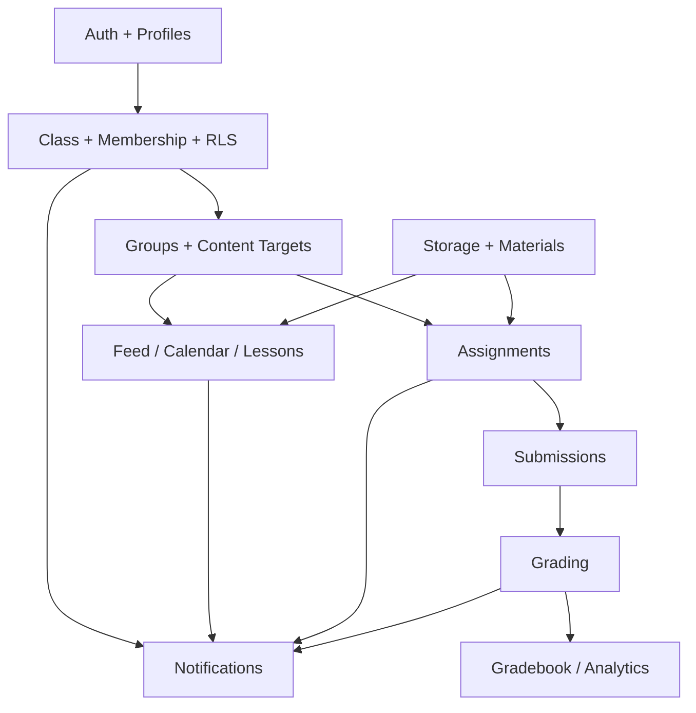

# Roadmap và backlog triển khai

## 1. Cách ưu tiên

- P0: thiếu là không thể vận hành dạy học trọn vòng.
- P1: tăng hiệu quả giáo viên sau khi luồng cốt lõi ổn định.
- P2: tối ưu/nâng cao, không chặn phát hành.
- Mỗi giai đoạn chỉ mở cho người dùng thật khi đạt Definition of Done và checklist production.

## 2. Các giai đoạn

### Giai đoạn 0 — nền tảng dự án

Kết quả:

- Khởi tạo Next.js/TypeScript/UI, Supabase và Vercel.
- Auth SSR, layout public/auth/dashboard, xử lý lỗi và loading chuẩn.
- Migration framework, profiles, audit base, taxonomy cấp/khối/môn.
- RLS baseline, Storage buckets, CI build trên Vercel, logging không lộ dữ liệu.

Phụ thuộc: tài khoản Supabase/Vercel, domain, email provider.

### Giai đoạn 1 — tài khoản và lớp học

Backlog P0:

- AUTH-01 đăng ký/xác minh/đăng nhập/đăng xuất.
- AUTH-02 quên/đổi mật khẩu và onboarding.
- CLS-01 tạo/sửa/danh sách/lưu trữ lớp.
- CLS-02 tham gia bằng mã/link, duyệt thành viên.
- CLS-03 ma trận role/capability và chuyển owner.
- CLS-04 nhóm học tập và target theo nhóm.
- CLS-05 settings và tạo lại mã lớp.

Mốc nghiệm thu: hai tài khoản giáo viên/học sinh hoàn tất luồng tạo → tham gia → duyệt, và truy cập chéo bị RLS từ chối.

### Giai đoạn 2 — tổ chức dạy học

Backlog P0:

- FEED-01 bảng tin, đính kèm, bình luận, ghim/hẹn giờ.
- CAL-01 lịch một lần/lặp tuần, sửa/hủy và link học.
- LES-01 module, bài giảng, trạng thái xuất bản, target nhóm.
- DOC-01 tài liệu lớp, preview/download signed URL.
- DASH-01 dashboard giáo viên/học sinh.
- NOTI-01 notification trong app cho nội dung/lịch.

Mốc nghiệm thu: giáo viên lên kế hoạch một tuần học; học sinh chỉ thấy đúng nội dung/lịch của lớp và nhóm.

### Giai đoạn 3 — bài tập, chấm và bảng điểm

Backlog P0:

- ASM-01 bài nộp tệp/tự luận.
- ASM-02 trắc nghiệm 5 loại câu và preview.
- SUB-01 autosave, nhiều lượt, nộp muộn, biên nhận/idempotency.
- GRD-01 auto-grade và manual grading.
- GRD-02 trả bài, feedback, chính sách hiện điểm/đáp án.
- BOOK-01 grade item/entry, bảng điểm và trang chi tiết học sinh.
- NOTI-02 nhắc hạn và thông báo trả bài.

Mốc nghiệm thu: hoàn tất trọn chu kỳ giao → nộp → chấm → trả → xem điểm mà không lộ đáp án sớm.

### Giai đoạn 4 — kho học liệu

Backlog P0:

- MAT-01 taxonomy Cấp → Khối → Môn.
- MAT-02 cây thư mục nhiều cấp và upload/link/text.
- MAT-03 metadata, tìm kiếm/lọc/sắp xếp.
- MAT-04 phạm vi private/class và gắn tài nguyên vào nội dung.
- MAT-05 soft delete, kiểm tra tham chiếu và dọn object rác.

Mốc nghiệm thu: một tài liệu được upload một lần, tái sử dụng trong nhiều lớp/bài giảng, quyền truy cập vẫn đúng.

### Giai đoạn 5 — hardening và phát hành P0

- Rà soát toàn bộ RLS bằng nhiều tài khoản production.
- Rate limit, quota file, CSP, audit, lỗi 404/403/500.
- Responsive, accessibility các luồng cốt lõi.
- Kiểm tra dữ liệu, backup/rollback, monitoring và runbook sự cố.
- Chạy checklist smoke trên production với lớp thử nghiệm riêng.

## 3. Backlog P1 sau phát hành

Thứ tự đề xuất:

1. Xuất CSV/XLSX bảng điểm và danh sách thành viên.
2. Điểm danh theo buổi học.
3. Ngân hàng câu hỏi, copy/import và tạo đề từ ngân hàng.
4. Phân tích câu hỏi, phân bố điểm, cảnh báo chưa nộp.
5. Sao chép lớp/bài giảng/bài tập sang học kỳ mới.
6. Rubric và nhận xét mẫu.
7. Platform material có quy trình duyệt.

## 4. Phụ thuộc quan trọng

Không nên làm giao diện bảng điểm trước khi chốt attempt, grade và release policy; không nên làm học liệu dùng chung trước khi chốt Storage authorization.

## 5. Definition of Done cho mỗi chức năng

- Luồng giáo viên và học sinh đã hoàn thiện, gồm empty/loading/error/forbidden states.
- Input được validate ở client để trải nghiệm tốt và ở server để đảm bảo an toàn.
- RLS/policy hoặc authorization server đã có; truy cập chéo được thử trên cloud.
- Có audit với thao tác nhạy cảm.
- Dùng được trên desktop và viewport điện thoại.
- Không lộ PII, token, đáp án, bài nộp trong log/cache/public URL.
- Migration production có thứ tự, pre-check và hướng rollback/forward-fix.
- Build Vercel thành công; smoke test production liên quan đã đạt.
- Tài liệu chức năng/data/deploy được cập nhật cùng thay đổi.

## 6. Mốc phát hành gợi ý

- Alpha nội bộ: hết giai đoạn 2, dùng một lớp thử nghiệm.
- Beta kín: hết giai đoạn 3, một số giáo viên/học sinh thật.
- P0 public: hết giai đoạn 5, có backup/monitoring/runbook.
- P1: phát hành từng chức năng bằng feature flag, không chờ một đợt lớn.

Không ấn định số tuần khi chưa biết quy mô đội, mức độ UI và số loại câu hỏi thực tế. Khi bắt đầu code, ước lượng theo từng epic sau một technical spike cho Auth/RLS, upload và nộp bài.
